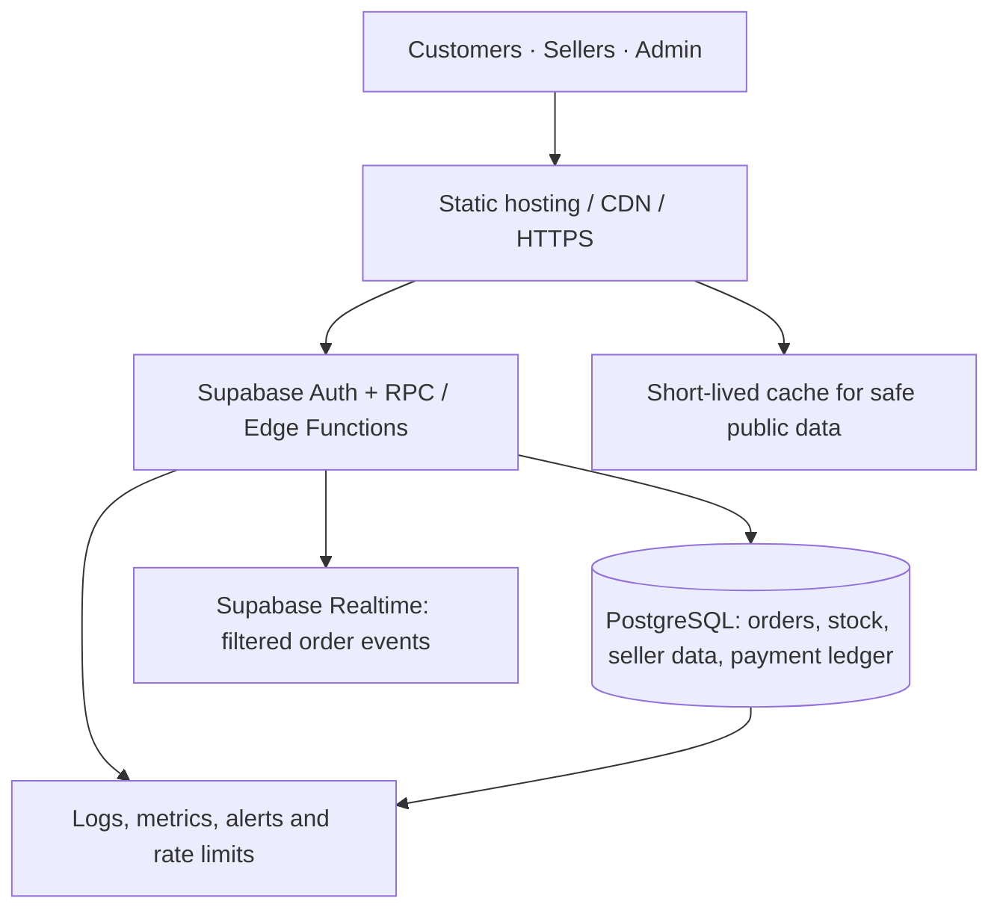

# Doodhwala 🥛

**A local-first milk marketplace for independent milk providers.**

Doodhwala is designed around one clear rule: this is not a catalogue for Amul, Jain Dairy, or other large dairy brands. The supply side is made of neighbourhood milk sellers who can serve customers in their own delivery area.

## Product vision

Think of the convenience and discovery model of a food-delivery marketplace, but focused entirely on milk:

- Customers discover independent providers near their location.
- Providers publish their milk types, pricing, timings, availability and delivery area.
- Customers can order one-off milk or recurring daily plans.
- Trust, verification, ratings, delivery reliability and locality are core product features.
- The customer interface is intentionally adapted for mobile, tablet/laptop and desktop rather than simply scaling one layout.

## Phase 2 provider side ✅

The repository now includes a complete browser-only provider workflow at `/provider.html`:

- 3-step provider onboarding
- Provider identity, owner and phone capture
- Primary milk type selection
- Base locality, city, PIN and delivery radius
- Delivery time window
- First milk product setup
- Provider dashboard with profile progress and readiness KPIs
- Milk catalogue with add / edit / delete / activate / pause
- Product search and stock filtering
- Service-area editor with delivery radius and time window
- Provider profile and trust/verification centre
- Separate provider mobile navigation and desktop sidebar
- LocalStorage persistence for Phase 2 demo data

This phase is intentionally backend-free. It proves the provider experience before authentication, database, document verification and real orders are connected.

## Phase 3 + 4 backend foundation ✅

The repository now contains the real marketplace backend contract and customer auth/checkout integration:

- Supabase schema + RLS migration for customers, local providers, milk products, service areas, addresses, orders and order items
- Provider verification state that starts at pending and cannot be self-approved through normal provider permissions
- Private atomic order-creation function that validates ownership, provider availability, product availability and database pricing
- Distance-aware provider discovery RPC using latitude/longitude + Haversine distance
- Supabase browser client configuration with the publishable key only
- Customer email/password authentication flow
- Provider console sync to Supabase when an authenticated provider is connected
- Delivery address capture
- Multi-provider cart grouping into separate provider orders
- Checkout → order creation flow
- Setup instructions in SUPABASE_SETUP.md

The Doodhwala Supabase project is provisioned and the production browser client is connected with the publishable key. Public provider inventory still requires provider onboarding plus approval.

## First MVP in this repository

- Doodhwala customer home/explore experience
- Local provider discovery cards
- Cow / buffalo / A2 / subscription filters
- Search by provider, area and milk type
- Functional cart with quantity controls
- LocalStorage cart persistence
- Desktop sidebar navigation
- Mobile bottom navigation
- Responsive layout with device-specific interaction patterns
- PWA manifest + offline service worker
- Doodhwala logo and brand foundation

The current provider listings are **demo data** for UI/product development and are not claims about real businesses.

## Product architecture planned next

### Customer
Account → location/address → nearby provider feed → provider page → product selection → cart → checkout → live order status → subscriptions → ratings

### Local provider
Provider signup → identity/business verification → service area → milk catalogue → price/availability → delivery schedule → incoming orders → route/delivery status → earnings

### Doodhwala operations
Provider moderation → verification → service-area management → disputes/support → marketplace analytics → fraud/safety controls

## Recommended backend direction

Supabase is a strong next step for the MVP because it can cover:

- PostgreSQL database
- Customer/provider authentication
- Row Level Security
- Storage for provider photos/documents
- Realtime order status
- Edge Functions for server-side operations

The current frontend is intentionally static-first so the product experience can be tested before introducing backend complexity.

## Suggested data model

Users, provider_profiles, provider_service_areas, milk_products, product_prices, delivery_slots, orders, order_items, subscriptions, addresses, reviews, provider_documents, notifications.

## Important marketplace rule

The production system should enforce a provider policy at onboarding/admin level so large packaged dairy brands cannot simply sign up as ordinary local providers. Doodhwala is intended to serve genuine independent/local milk sellers.

## Development phases

1. Customer MVP and responsive UX ✅
2. Provider onboarding + provider dashboard ✅
3. Supabase schema + Auth + RLS ✅
4. Location-aware provider discovery ✅
5. Product catalogue + availability ✅
6. Cart → address → checkout ✅
7. Orders + notifications
8. Recurring milk subscriptions
9. Payments
10. Verification, ratings, support and admin
11. Production hardening + analytics

## Local development

This first build is plain HTML/CSS/JavaScript and can be served by any static web server. It can also be deployed as a static site and installed as a PWA.

## P0 order journey verification (release gate)

The core journey is: **customer checkout → provider order queue → provider status changes → customer tracking**. Use this checklist in an isolated staging Supabase project with authorized test accounts. **Do not create synthetic customer/order records in production to test reporting.** If staging is unavailable, wait for a genuine, agreed order rather than manufacturing a live order.

### Pre-flight

- Confirm a customer account and an approved provider account belong to the same staging project.
- Confirm the provider is approved, available, has service coverage for the selected delivery pin, and has an available backend-linked milk product.
- Confirm the browser client contains only the Supabase publishable key; never put the service-role key in the static site.
- Use a phone-sized browser viewport, then repeat on an installed PWA after the latest service worker activates.

### Customer checks

1. Sign in and open checkout from a real backend-linked product in the provider's catalogue.
2. Load an existing delivery address, edit it, save it, and verify that the existing address is updated rather than duplicated.
3. Set or verify the delivery pin; confirm invalid/out-of-range coordinates are not used.
4. Submit once. Confirm the UI prevents double-submission and the order appears exactly once in the customer order history.
5. Confirm the success screen's **Track my order** link opens order history. Leave that page open: status should update through Realtime, and the visible-page fallback should refresh within about 60 seconds if an event is missed.
6. Reload the page and verify the order and latest status remain correct. Test a transient network failure only in staging and verify retry does not create a duplicate order.

### Provider checks

1. Open the provider dashboard for the matching account. The incoming order should appear in the order queue; wait for Realtime, then for the fallback refresh if needed.
2. Accept the order and move it through the allowed workflow: packing → ready → out for delivery → delivered.
3. Verify each change appears on the customer's order history and timeline. Check that a stale/expired order cannot be accepted and that unauthorized accounts cannot change the order.
4. Confirm queue totals change once per transition and no demo listing is presented as a live provider.

### P0 pass criteria

The journey passes only when the same order can be followed end-to-end by its real database ID, the customer and provider see consistent statuses after refresh/reconnect, retry is idempotent, address/pin data are correct, and the journey works on an actual mobile device. Static CI does **not** prove these account-, RLS-, Realtime-, permission-, GPS-, or device-level behaviours. Record any staging order ID and observed timestamps outside production analytics before calling P0 end-to-end complete.

---

## Project links

- **GitHub profile:** https://github.com/Mahin98250
- **Portfolio repository:** https://github.com/Mahin98250/Porfolio
- **More projects:** https://github.com/Mahin98250?tab=repositories

> Live demo links will be added only after the deployment URL is verified.

## Doodhwala Pay — foundation in progress

The payment foundation introduces a server-owned `payment_transactions` ledger and an authenticated `doodhwala-pay` Edge Function for idempotent payment-intent creation and customer-owned status lookup. Amounts are derived from the stored order total on the server and converted to integer paise.

### Payment security and release status

A read-only audit of the connected Doodhwala Supabase project found that the payment migrations and `doodhwala-pay` function are not deployed there yet. Direct seller UPI is not bank-verified, and the project is not approved for real-money/high-volume use. See [PAYMENT_SECURITY_READINESS.md](./PAYMENT_SECURITY_READINESS.md) for verified findings, hardening changes, and launch gates.

**Important launch boundary:** the automated `doodhwala-pay` gateway foundation is not live and does not collect or move money (`gateway_ready: false`, `money_moved: false`). Direct seller UPI is a separate manual-confirmation flow: money is intended to go from the customer's UPI app to the seller's UPI address, but Doodhwala cannot independently verify bank settlement. Automated collection/verification remains disabled until a suitable acquiring/payment provider or official merchant/bank integration is configured with server-side secrets, verified signed webhooks, replay protection, reconciliation, failure/refund handling, and required reviews. Never collect card numbers, CVV, UPI PINs, or banking passwords in Doodhwala. Never mark an order paid from a browser redirect or client callback alone.

Before enabling live collection:
1. Apply the reviewed SQL migration `20261022120000_doodhwala_pay_foundation.sql`.
2. Deploy `supabase/functions/doodhwala-pay` with JWT/session verification behavior tested against the production project.
3. Select a payment provider/acquirer and configure its credentials only as server-side secrets.
4. Implement provider-specific order creation, signed webhook verification, replay protection, reconciliation, refunds and idempotent state transitions.
5. Add sandbox and end-to-end tests for success, failure, cancellation, duplicate webhooks, partial refunds and amount mismatch.
6. Review applicable Indian payment, tax, privacy, marketplace and consumer-protection requirements with qualified professionals before production collection.

The current API explicitly reports `gateway_ready: false` and `money_moved: false`; an intent is not proof of payment.

## Scalability roadmap — one app, managed infrastructure

**Goal:** grow from the first local customers to thousands of simultaneous active users without prematurely splitting the product into multiple applications or microservices. Traffic figures below are **proposed test targets, not measured capacity or guarantees**.

### Architecture direction

Keep one Doodhwala product with customer, seller, admin, checkout, orders and payment experiences. Let managed infrastructure scale independently behind it.

- **Frontend:** static web/PWA deployment on a suitable commercial static host; preview releases before production.
- **Backend:** retain Supabase initially because this repository already uses PostgreSQL, Auth, RLS, RPC functions and Realtime.
- **Source of truth:** PostgreSQL owns authoritative pricing, stock, order state, capacity and payment state. A cached page or browser callback never overrides it.
- **One app is not one fixed server:** keep the product unified while upgrading managed database, hosting, Realtime capacity or background processing only when measurements justify it.

### Current verified baseline (2026-10-24)

- The production-connected Supabase migration history currently ends at `20261013164921`. Later repository migrations—including payment foundation and newer query-index work—are not evidence of production deployment. Reconcile migration history and test the sequence in an isolated staging project before applying changes to production.
- The repository contains a bounded nearby-provider search migration, order-capacity query indexes, and an existing manual staging-only k6 workflow for the read-only discovery RPC. The workflow's proposed load profile ramps through 1, 5, 10, 25 and 50 requests/second; it has **not been run against a configured staging project**, so it proves no achieved capacity.
- Order creation already has a trusted RPC with server-side pricing and an idempotency key, plus seller capacity checks. Keep its locking/capacity semantics safe while optimizing query cost; do not trade correctness for raw throughput.
- Supabase Realtime is used for order/provider experiences and requires a separate connection, fan-out and reconnect test.
- Payment source code contains COD, direct seller UPI instructions and a bookkeeping intent foundation, but automated collection remains disabled. The current payment endpoint explicitly reports `gateway_ready: false` and `money_moved: false`. Neither an UPI redirect nor a seller attestation independently verifies bank settlement.
- Static/contract tests and a staging harness are useful guardrails, but neither is a substitute for browser-to-database end-to-end tests, real query plans, or measured staging load tests.

**Do not call the system production-scale until the test results below are recorded.**

### Phase-by-phase execution plan

#### Phase 1 — staging and baseline
Read the executable checklist in [`docs/STAGING_BASELINE.md`](./docs/STAGING_BASELINE.md), the read-only SQL diagnostics in [`scripts/staging-schema-audit.sql`](./scripts/staging-schema-audit.sql), the [dated production migration-history snapshot](./supabase/audit/production-migration-history-2026-10-24.json) with its [static drift report](./scripts/test-production-migration-manifest.mjs), and the [focused live-schema snapshot](./supabase/audit/production-schema-check-2026-10-24.json). The staging project must be separate from production; do not run synthetic writes or load tests against the production project.

- Create a dedicated staging Supabase project with separate credentials and synthetic test accounts/data.
- Reconcile repository migration ordering with the target database's migration history; apply and validate changes in staging first.
- Record the tested Git commit, hosting configuration, required environment variables, DB compute/connection settings and rollback procedure.
- Run customer checkout, seller order handling, admin read paths, auth/RLS checks and order tracking in staging.
- Confirm automated backups and perform a restore drill.
- Run the existing read-only k6 discovery workflow against staging only.

**Exit gate:** reproducible staging, recorded starting latency/error/resource metrics, no unresolved critical authorization or order-integrity issues, and a documented restore/rollback path.

#### Phase 2 — production frontend deployment
- Choose Cloudflare Pages or another suitable commercial static host based on current pricing, limits, domain needs and preview support.
- Preserve the existing customer, seller and admin experiences; this is a hosting change, not a product rewrite.
- Verify every route, asset, project-base path, PWA manifest, offline fallback and service-worker cache revision.
- Configure HTTPS, custom domain, preview deployments and a rollback-to-last-known-good release process.
- Test mobile and desktop routes from a clean browser and an installed PWA.

**Exit gate:** every intended route and asset is verified on the selected host, with a tested rollback and no accidental secret keys in frontend assets.

#### Phase 3 — PostgreSQL query performance
- Confirm which repository migrations are actually applied before measuring the live schema.
- Grow **synthetic staging data** to realistic seller, product, customer and order volumes.
- Use query statistics and `EXPLAIN (ANALYZE, BUFFERS)` in staging to identify expensive reads, scans, lock waits and repeated queries.
- Keep nearby-provider search bounded; return only necessary columns and paginate order histories/admin lists.
- Validate indexes against real query plans, including the open-order and daily-capacity checks.
- Keep order creation atomic and seller-capacity checks correct under concurrent requests.

**Exit gate:** important query plans, p50/p95 latency and lock behavior are recorded at representative data sizes; every index added has a measured use case.

#### Phase 4 — caching and browser efficiency
- Cache static assets at the CDN and consider a short TTL for safe public categories or provider listings.
- Invalidate or refresh public cache entries when seller price, stock or availability changes.
- Never publicly cache customer addresses, sessions, personalized orders or account-level data.
- Debounce search, cancel obsolete requests, bound results, avoid duplicate dashboard fetches and use retry backoff.
- Treat local/offline cache as display convenience only; refresh authoritative price/stock before order creation.

**Exit gate:** repeated browsing performs less database work without allowing stale price, stock or capacity to authorize an order.

#### Phase 5 — checkout, payments and data integrity
- Keep order creation in a trusted RPC/backend path; derive price and payable amount from stored database values.
- Use durable idempotency keys and database uniqueness to make retries safe.
- Protect stock and seller capacity with transactions and appropriate locking; test simultaneous checkouts and race conditions.
- Store payment attempts and auditable state transitions server-side. Use integer paise for money calculations.
- Only automatically mark online payments successful after verifying a trusted provider/acquirer event server-side, including signature, amount, currency, order mapping and replay/duplicate protection.
- Keep COD and direct-to-seller UPI transparently labelled. Seller-entered confirmation and a UPI redirect are not bank-verified settlement.
- Add safe failure, cancellation, refund/reversal, duplicate-payment, mismatch and reconciliation flows before enabling real-money collection.
- Rate-limit sensitive actions such as login, order creation and promo validation.

**Exit gate:** concurrent tests produce no duplicate orders or invalid payment transitions; browser-only events cannot mark a payment paid; documented rollback and reconciliation procedures exist.

#### Phase 6 — Realtime fan-out
- Audit every `.channel()`, `.on("postgres_changes", ...)` and `.subscribe()` call in the repo.
- Ensure channels are filtered to the necessary user/order/provider and are removed on navigation, sign-out and account change.
- Remove duplicate subscriptions and avoid refreshing entire dashboards for small status changes.
- Measure connection bursts, event throughput, reconnect storms, message fan-out and database impact.
- Evaluate private Supabase Realtime Broadcast for high-fan-out events instead of relying on Postgres Changes for every subscriber, after testing authorization and delivery behavior.
- Use bounded exponential backoff and refresh the minimal authoritative state after reconnect.

**Exit gate:** recorded connection/message capacity and reconnect behavior at the target profile, with no uncontrolled subscription growth or full-dashboard refresh storm.

#### Phase 7 — realistic load testing
Extend the existing manual staging-only workflow rather than running synthetic traffic against production. Add separate scenarios for browsing, authentication, search, checkout/order writes, seller status transitions and realtime tracking. Use synthetic data and a load generator with enough capacity for the intended test.

| Stage | Proposed profile | Purpose |
| --- | --- | --- |
| Baseline | 1–10 RPS, then existing 1/5/10/25/50 RPS discovery ramp | Confirm basic behavior and safe ramp-up |
| Early scale | 100–250 virtual users; profile actual RPS separately | Discover early resource/locking bottlenecks |
| Launch readiness | 1,000 simultaneous active users and a defined RPS mix | Validate realistic browse + order load |
| Growth readiness | 5,000 simultaneous active users | Evaluate connection, query and cache scaling |
| Large-scale target | 10,000 simultaneous active users; example peak 500 RPS | A later acceptance target, not a present guarantee |

Virtual users, concurrent open connections and requests per second (RPS) are different metrics. Ten thousand people using cached pages do not equal ten thousand simultaneous database writes. Document scenario mix, payloads, think time, ramps, test duration and generator utilization with every result.

**Initial proposed service objectives (refine after baseline):**
- Ordinary read API: p95 under 500 ms.
- Critical checkout API: p95 under 800 ms.
- Unexpected HTTP failures: below 0.5% in a steady-state test.
- Duplicate orders from retry: zero.
- Incorrect/duplicate payment state transitions: zero.
- No sustained database resource saturation or unbounded queue growth.
- After a burst, services return to the baseline range without manual intervention.

These are targets, not current measurements. Capture p50/p95/p99, error rate, throughput, DB CPU/memory/connection use, lock waits, Realtime connections/events and dropped iterations. Test gradual ramps, sustained load, sudden spikes and recovery separately. Use an appropriately provisioned or distributed load generator for large profiles; one small GitHub Actions runner cannot establish a 10,000-user capacity claim.

**Exit gate:** each tested profile has a saved report, clear pass/fail criteria, a known bottleneck and a recovery plan.

#### Phase 8 — scale managed infrastructure by evidence
- Upgrade Supabase compute or connection capacity only after metrics show a real bottleneck.
- Review current Realtime connection/message quotas before setting a target; capacity depends on the selected plan and configuration.
- Consider read replicas for proven read-heavy workloads where consistency requirements allow them.
- Move retry-heavy or slow asynchronous work to managed queues/background workers when appropriate.
- Consider partitioning or separate services only when workload patterns, isolation or deployment needs justify the added cost and operational complexity.

**Exit gate:** every upgrade addresses a measured bottleneck and records cost, expected benefit, rollback and a post-change benchmark.

### Cost and reliability rules

1. Start with one app, Supabase and a suitable static frontend host. Do not build microservices or operate extra servers before evidence requires them.
2. Budget for a staging project, backups/recovery, logging and alerts before exposing real orders to a large audience.
3. Review current official provider pricing, quotas and overage rules before upgrading; do not rely on static price claims in this README.
4. Apply migrations through a controlled process and review RLS, function privileges, secrets and exposed-table grants.
5. Never expose a Supabase service-role/secret key in browser code.
6. Treat load-test results as valid only for the exact commit, data size, schema, plan, region, scenario and load generator used.
7. Never run stress tests or synthetic order writes against production unless specifically authorized and carefully bounded.

### Operational release checklist

- [ ] Staging project configured with separate secrets and synthetic data.
- [ ] Migration history reconciled and schema validated against repo.
- [ ] RLS and cross-customer/cross-seller access tests pass.
- [ ] Checkout retries and concurrent stock/capacity tests pass.
- [ ] Payment events are auditable; no client-only success path.
- [ ] Realtime subscriptions clean up correctly and reconnect safely.
- [ ] Baseline and staged k6 reports saved for the tested commit.
- [ ] Backup restore and release rollback have been demonstrated.
- [ ] Alerts cover latency, errors, database capacity and realtime failures.
- [ ] Production rollout has measured limits, ownership and an incident-response plan.

### Immediate implementation order

1. Establish staging and verify repository migrations against the target schema.
2. Run the existing read-only discovery load test and record a baseline.
3. Validate the end-to-end customer → seller order lifecycle and payment safety gates.
4. Improve the slowest measured query and rerun its scenario.
5. Audit realtime subscriptions and remove unnecessary fan-out.
6. Deploy/verify the commercial frontend host and PWA routes.
7. Extend staging load scenarios from reads to controlled synthetic checkout/order writes.
8. Increase target profiles only after the previous stage passes.

## Branding asset contract

`assets/mascot.png` is the shared Doodhwala mascot for customer, seller, owner/admin, account, checkout, support, legal, and offline screens. The browser favicon and PWA manifest use the same asset. When changing the mascot, update this shared asset reference and the service-worker cache revision together so installed apps refresh reliably. The current service-worker cache revision for this release is `doodhwala-v87`. Shared pages use the `resilience.js?v=20261023.5` cache-busted bootstrap URL. Runtime redirects, dynamic assistant surfaces, seller storefronts, product detail, order/support links, and regression fixtures use the renamed `/Doodhwala/` project base. The homepage and customer transaction pages link to the draft privacy, terms, cancellation/refund, seller agreement and complaints sections.
